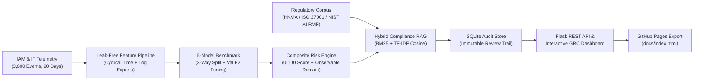
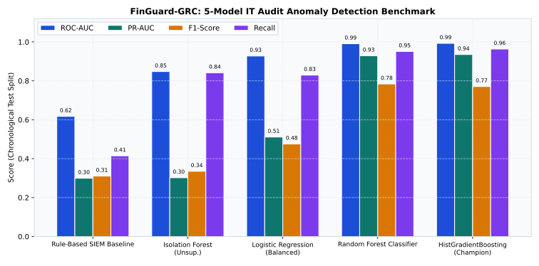
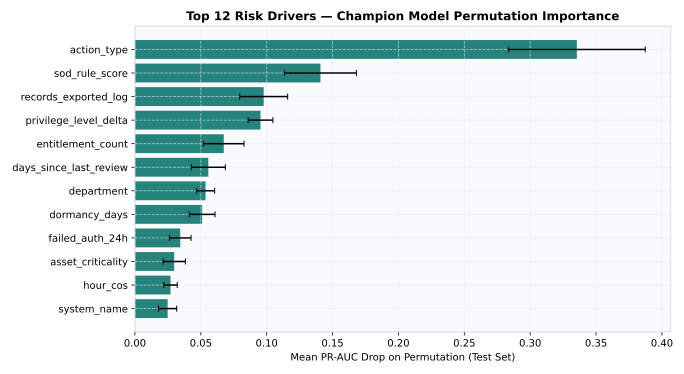
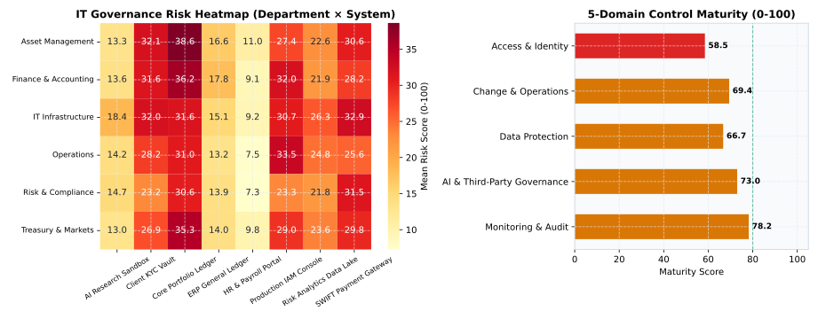

# FinGuard-GRC: Enterprise AI Governance, IT Access Anomaly Detection & Compliance Audit Platform

[](https://www.python.org/)
[](.github/workflows/ci.yml)
[](LICENSE)
[](data/knowledge_base/regulatory_controls.json)

> **A production-structured Information Technology Management (ITM) & Information Systems Auditing platform** that combines 3-way temporal machine learning anomaly detection, composite IT governance risk scoring, hybrid BM25 + TF-IDF regulatory compliance retrieval, and an interactive human-in-the-loop audit triage dashboard for financial institutions.

**[Interactive Live Demo (GitHub Pages)](https://aLLLENNCJX.github.io/finguard-grc/)** · **[Static Snapshot (`docs/index.html`)](docs/index.html)** · **[System Architecture](docs/architecture.md)** · **[Full Evaluation Report](docs/evaluation_report.md)** · **[Known Limitations & Research Roadmap](docs/RESEARCH_ROADMAP.md)**

---

## 🎯 Problem Statement & Motivation

Financial institutions face a dual IT governance challenge:
1. **Alert Fatigue vs. Audit Blind Spots**: Traditional rule-based SIEM thresholds generate high false-positive volumes on legitimate operational edge cases (e.g., approved weekend IT maintenance or quarterly regulatory bulk exports) while missing subtle, multi-feature policy violations such as **privilege creep**, **Segregation of Duties (SoD) conflicts**, and **Shadow AI data leakage**.
2. **Disconnected Detection & Compliance**: Raw anomaly scores rarely map directly to auditable regulatory clauses (**HKMA SPM TM-G-1**, **HKMA C-RAF**, **ISO/IEC 27001:2022**, **NIST AI RMF 1.0**) or quantify remediation ROI for IT leadership.

**FinGuard-GRC** bridges **Data Science & AI** with **Enterprise IT Management**, transforming raw IAM/access telemetry into explainable, regulation-mapped, and auditable governance decisions.

---

## 🎓 Academic & IT Management Alignment

Designed specifically around core Information Technology Management and Information Systems Auditing competencies:

| IT Management Pillar | FinGuard-GRC Implementation |
| :--- | :--- |
| **Information Systems Auditing** | Immutable SQLite `audit_reviews` ledger, Segregation of Duties (SoD) conflict detection, auto-generated remediation briefs, and human-in-the-loop triage workflow (`Confirmed Violation`, `False Positive`, `Escalated to CISO`). |
| **Financial Technology Management** | Asset-criticality-weighted risk scoring (`0–100`) across `SWIFT Payment Gateway`, `Core Portfolio Ledger`, and `Client KYC Vault`, aligned with HKMA TM-G-1 & C-RAF. |
| **AI for Digital Transformation** | 3-way temporal ML anomaly detection (`HistGradientBoosting`) paired with **Shadow AI leakage** monitoring (`NIST AI RMF 1.0`) and an optional OpenAI-compatible audit brief advisor. |
| **Business Data Analysis** | 5-model chronological holdout benchmark (`ROC-AUC`, `PR-AUC`, `F2-score`), permutation feature importance, dynamic error analysis, and an out-of-sample What-If **Remediation ROI Simulator**. |
| **Foundations of Management in the IT Context** | 5-domain governance maturity scoring (`Access & Identity`, `Change & Operations`, `Data Protection`, `AI & Third-Party Governance`, `Monitoring & Audit`) inferred strictly from observable telemetry. |

---

## 🛠️ System Architecture



---

## 📊 Quantitative Results & Evaluation

All experiments are evaluated on a strict **3-way chronological split**:
- **Training**: Days `0–53` (`2,160` events, `11.02%` violation rate)
- **Validation** *(threshold calibration)*: Days `54–66` (`520` events, `10.00%` violation rate)
- **Holdout Test** *(untouched final evaluation)*: Days `67–89` (`920` events, `8.91%` violation rate, `82` actual violations)

### 1. Five-Model Anomaly Detection Benchmark (Holdout Test Set)

| Model | ROC-AUC | PR-AUC | Precision | Recall | F1 | F2 | FPR | Alert Compression | Hrs Saved / Qtr |
| :--- | :---: | :---: | :---: | :---: | :---: | :---: | :---: | :---: | :---: |
| Rule-Based SIEM Baseline | 0.6172 | 0.2992 | 0.2482 | 0.4146 | 0.3105 | 0.3656 | 0.1229 | 85.1% | 82.5h |
| Isolation Forest (Unsupervised) | 0.8476 | 0.3018 | 0.2091 | 0.8415 | 0.3350 | 0.5243 | 0.3115 | 64.1% | 51.8h |
| Logistic Regression (Balanced) | 0.9276 | 0.5111 | 0.3333 | 0.8293 | 0.4755 | 0.6391 | 0.1623 | 77.8% | 57.8h |
| Random Forest Classifier | 0.9908 | 0.9291 | 0.6667 | 0.9512 | 0.7839 | 0.8764 | 0.0465 | 87.3% | 130.5h |
| **HistGradientBoosting (Champion)** | **0.9926** | **0.9351** | **0.6423** | **0.9634** | **0.7707** | **0.8758** | **0.0525** | **86.6%** | **126.8h** |

* **Key Takeaway**: Switching from rigid SIEM heuristics (`F1 = 0.3105`, `PR-AUC = 0.2992`, `Recall = 41.5%`) to `HistGradientBoosting` with validation-calibrated F2 thresholding (`0.33`) boosts violation recall by **+54.88 percentage points** (`96.3%`) while cutting false positive rate from `12.29%` to `5.25%` and saving **126.8 analyst hours/quarter**.




### 2. Explainability & Dynamic Error Analysis

- **Top Risk Drivers (Holdout Permutation Importance)**: `action_type` (`+0.3354` PR-AUC drop), `sod_rule_score` (`+0.1408`), `records_exported_log` (`+0.0977`), `privilege_level_delta` (`+0.0953`), `entitlement_count` (`+0.0674`).
- **Confusion Matrix (Champion)**: `TP = 79`, `FP = 44`, `FN = 3`, `TN = 794`.
- **Observed Error Archetypes**:
  - *False Positives (`44`)*: `7/44` involved off-hours activity despite valid ITSM change tickets, `5/44` were Risk & Compliance bulk exports, and `7/44` exhibited temporary cross-department SoD scores `>= 0.45`.
  - *False Negatives (`3`)*: `1` `privilege_creep`, `1` `dormant_account_abuse`, and `1` `shadow_ai_leakage` with stealth profiles (median `505` records exported, median SoD `0.07`, ticket present `2/3`).





### 3. Hybrid Compliance RAG Ablation Study
Evaluated across **24** paraphrased financial IT audit queries against **18** controls from HKMA SPM TM-G-1, HKMA C-RAF, ISO/IEC 27001:2022, and NIST AI RMF 1.0:

| Retrieval Mode | Recall@1 | Recall@3 | MRR |
| :--- | :---: | :---: | :---: |
| TF-IDF Cosine Only | 83.3% | 95.8% | 0.8889 |
| BM25 Lexical Only | 91.7% | 100.0% | 0.9514 |
| **Hybrid (0.55 TF-IDF + 0.45 BM25)** | **91.7%** | **100.0%** | **0.9514** |

---

## ⚙️ Quick Start (Zero External API Keys Required)

### 1. Local Virtual Environment & Pipeline
```bash
git clone https://github.com/aLLLENNCJX/finguard-grc.git
cd finguard-grc

python -m venv .venv
# Windows PowerShell:
.\.venv\Scripts\Activate.ps1
# macOS/Linux:
# source .venv/bin/activate

pip install -r requirements.txt

# Run full deterministic data, ML, RAG, charts, and static HTML export
PYTHONPATH=src python -m finguard.cli run-all

# Launch interactive Flask REST API & Web Dashboard
PYTHONPATH=src python -m finguard.cli serve --host 127.0.0.1 --port 8050
```
Open **`http://127.0.0.1:8050`** in your browser to explore the 5-tab interactive GRC dashboard (with Light/Dark mode toggle).

### 2. Run Automated Tests
```bash
python -m pytest -v
```

### 3. Optional Docker & Optional LLM Advisor
```bash
docker compose up --build
```
To enable optional OpenAI-compatible narrative refinement for audit briefs (disabled by default):
```bash
export FINGUARD_LLM_ENABLED=true
export FINGUARD_LLM_API_KEY="your-api-key"
export FINGUARD_LLM_MODEL="gpt-4o-mini"
```

---

## 🔌 REST API Reference

| Endpoint | Method | Description |
| :--- | :---: | :--- |
| `/api/health` | `GET` | Service health check |
| `/api/summary` | `GET` | Executive KPIs, live review stats, 5-domain maturity scores, and Department × System heatmap |
| `/api/events` | `GET` | Filterable audit findings (`?tier=Critical&department=...&status=...&limit=120`) |
| `/api/events/<id>/brief` | `POST` | Generate deterministic (or optional LLM-enhanced) remediation brief for a finding |
| `/api/events/<id>/review` | `POST` | Record immutable human-in-the-loop auditor disposition |
| `/api/compliance/query` | `POST` | Hybrid BM25 + TF-IDF regulatory control retrieval (`mode`: `hybrid`, `bm25`, `tfidf`) |
| `/api/models/evaluation` | `GET` | 5-model benchmark metrics, ROC/PR curves, feature importance, error analysis, RAG ablation |
| `/api/simulate/remediation` | `POST` | Out-of-sample What-If threshold, domain focus & analyst capacity ROI simulation |

---

## 📁 Repository Structure

```text
finguard-grc/
├── .github/workflows/ci.yml           # GitHub Actions CI (pytest + pipeline verification)
├── data/
│   ├── knowledge_base/
│   │   └── regulatory_controls.json   # HKMA TM-G-1, C-RAF, ISO 27001, NIST AI RMF corpus
│   └── generated/                     # Generated telemetry, benchmark JSON, snapshot
├── docs/
│   ├── assets/                        # Auto-generated 180-DPI charts + dashboard preview
│   ├── architecture.md                # 3-way split, leakage controls & governance mapping
│   ├── evaluation_report.md           # Auto-generated quantitative benchmark report
│   ├── RESEARCH_ROADMAP.md            # 6 future research & optimization directions
│   └── index.html                     # Standalone GitHub Pages interactive dashboard
├── src/finguard/
│   ├── api/                           # SQLite AuditStore & Flask REST API
│   ├── compliance/                    # Hybrid BM25+TF-IDF RAG, maturity & ROI simulator
│   ├── data/                          # Deterministic financial IT audit telemetry generator
│   ├── features/                      # Leak-free ColumnTransformer feature pipeline
│   ├── models/                        # 5-model 3-way benchmark & composite risk scorer
│   ├── reporting/                     # Matplotlib charts, markdown report & static HTML export
│   ├── web/dashboard.html             # Zero-CDN Light/Dark interactive GRC dashboard
│   └── cli.py                         # Unified CLI (`run-all`, `serve`)
├── tests/                             # 7 unit & API integration tests
├── Dockerfile & docker-compose.yml
├── pyproject.toml
└── requirements.txt
```

---

## 🔬 Known Limitations & Future Research

`FinGuard-GRC v1.0` explicitly documents its current methodological boundaries (synthetic telemetry vs. production SIEM schema drift, compact 18-clause corpus, uncalibrated tree margins, single-event tabular scope, and constant expected-loss ROI heuristics) alongside six concrete research directions in **[docs/RESEARCH_ROADMAP.md](docs/RESEARCH_ROADMAP.md)**:
1. Temporal concept drift monitoring (PSI/KS) & isotonic probability calibration
2. Graph Neural Networks (GraphSAGE / R-GCN) for multi-hop toxic IAM entitlement paths
3. Selection-bias-aware active learning from human `audit_reviews`
4. Dense semantic retrieval + cross-encoder reranking for full HKMA/SFC regulatory PDFs
5. Causal uplift modeling (DoWhy / EconML) for remediation ROI
6. Privacy-preserving federated audit analytics under Hong Kong PDPO
