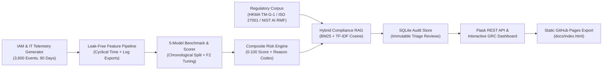

# FinGuard-GRC System Architecture & Governance Design

## 1. High-Level Architecture

FinGuard-GRC is structured as a modular, four-layer enterprise IT governance and audit analytics platform:

---

## 2. Three-Way Temporal Split & Data Leakage Prevention

Enterprise IT audit models operate sequentially in time: historical access logs train the detector, a subsequent validation window calibrates operating thresholds, and an untouched future holdout window evaluates generalization. To mirror production deployment:
- **3-Way Chronological Split**: Events are split strictly by `day_index` — **Training** (Days `0–53`, 60%), **Validation** (Days `54–66`, 15%), and **Holdout Test** (Days `67–89`, 25%).
- **Fit-on-Train Preprocessing**: `StandardScaler` and `OneHotEncoder` inside `ColumnTransformer` are fit exclusively on Training data.
- **Validation-Only Threshold Calibration**: The F2-maximizing operating threshold (prioritizing recall of compliance violations while bounding analyst false-positive fatigue) is selected strictly on Validation probabilities before touching the Holdout Test set.
- **Zero Label Leakage Downstream**: Compliance control mapping (`HybridComplianceRetriever.map_finding_controls`) and 5-domain maturity scoring (`compute_domain_maturity`) operate exclusively on observable telemetry and inferred `primary_domain` — never on ground-truth `violation_type` labels.
- **Realistic Benign Edge Cases**: The telemetry generator injects legitimate off-hours IT maintenance with valid ITSM change tickets, authorized quarterly HKMA regulatory bulk exports, temporary cross-department grants, and internal AI sandbox experiments so that rigid SIEM rules suffer realistic false positives and models must learn multi-feature context.

---

## 3. Composite IT Governance Risk Scoring (0–100)

Raw model probabilities alone are insufficient for IT governance prioritization. FinGuard-GRC combines:
- **60% Calibrated ML Anomaly Probability** (`HistGradientBoostingClassifier`)
- **20% Asset Criticality Tier** (normalized 1–5 criticality across `SWIFT Payment Gateway`, `Core Portfolio Ledger`, `Client KYC Vault`, etc.)
- **20% Deterministic Policy & SoD Severity Signal** (elevated SoD conflict score, missing change ticket on production config change, unapproved external AI endpoint egress, dormant account reactivation)

Each finding is assigned a discrete tier (`Critical >= 80`, `High 60–79`, `Medium 40–59`, `Low < 40`) along with up to three human-readable **Reason Codes** for auditor explainability.

---

## 4. Regulatory Framework Mapping

| Control Domain | HKMA SPM / C-RAF | ISO/IEC 27001:2022 | NIST AI RMF 1.0 |
| :--- | :--- | :--- | :--- |
| **Access & Identity** | TM-G-1 4.1, 4.3 | A.5.15, A.5.18, A.8.2 | — |
| **Change & Operations** | TM-G-1 5.2 | A.5.3, A.8.32 | — |
| **Data Protection** | TM-G-1 6.1 | A.8.12, A.8.24 | — |
| **AI & Third-Party Governance** | TM-G-1 7.4 | — | GOVERN 1.2, MAP 1.5 |
| **Monitoring & Audit** | C-RAF 3.2 | A.8.15 | MEASURE 2.6, MANAGE 2.2 |

---

## 5. Human-in-the-Loop Auditability & Security Principles

- **Immutable Review Ledger**: Every auditor disposition (`Confirmed Violation`, `False Positive`, `Remediation Assigned`, `Escalated to CISO`) appends an immutable record to `audit_reviews` with reviewer identity, rationale, and UTC timestamp.
- **Zero-Key Offline Reproducibility**: Core ML scoring, hybrid BM25 + TF-IDF compliance retrieval, and deterministic audit brief generation run 100% locally without external API keys. An optional OpenAI-compatible advisor (`FINGUARD_LLM_ENABLED=true`) can enrich summaries when configured.
- **Container Hardening**: `Dockerfile` runs as non-root UID `10001` with a built-in `/api/health` check.
