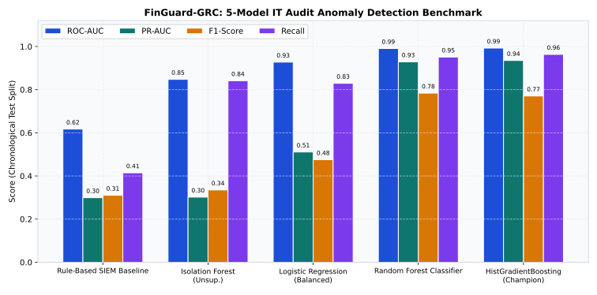
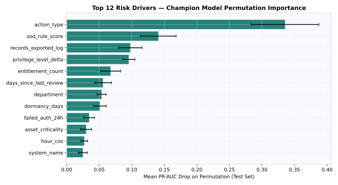
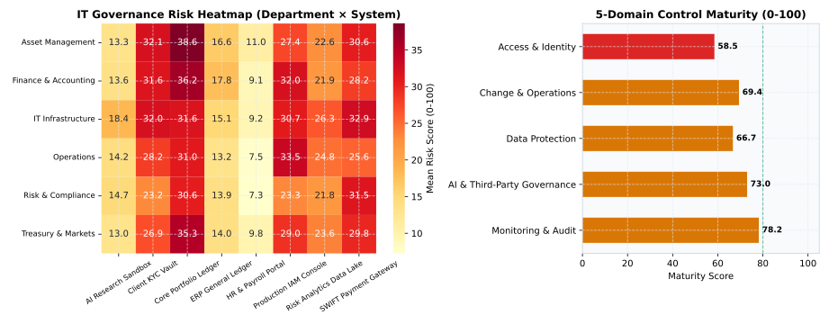

# FinGuard-GRC — Technical Evaluation & Audit Benchmark Report

> Auto-generated from deterministic pipeline run (`seed=42`). All metrics are measured on a strict **3-way chronological split** (Days 0–53 Train / Days 54–66 Validation / Days 67–89 Holdout Test).

## 1. Dataset & 3-Way Chronological Split Summary
- **Total Audited Events**: 3,600
- **Training Split**: 2,160 events (Days 0–53, violation rate: 11.02%)
- **Validation Split** *(threshold calibration)*: 520 events (Days 54–66, violation rate: 10.00%)
- **Holdout Test Split** *(final evaluation)*: 920 events (Days 67–89, violation rate: 8.91%)
- **Leakage Controls**: `ColumnTransformer` scalers and encoders are fit exclusively on Training data; F2-maximizing operating thresholds are tuned strictly on Validation probabilities; downstream compliance mapping and maturity scoring use zero ground-truth labels.

---

## 2. Five-Model Comparative Benchmark (Holdout Test Set)

| Model | ROC-AUC | PR-AUC | Precision | Recall | F1 | F2 | FPR | Alert Compression | Hrs Saved / Qtr |
| :--- | :---: | :---: | :---: | :---: | :---: | :---: | :---: | :---: | :---: |
| Rule-Based SIEM Baseline | 0.6172 | 0.2992 | 0.2482 | 0.4146 | 0.3105 | 0.3656 | 0.1229 | 85.1% | 82.5h |
| Isolation Forest (Unsupervised) | 0.8476 | 0.3018 | 0.2091 | 0.8415 | 0.3350 | 0.5243 | 0.3115 | 64.1% | 51.8h |
| Logistic Regression (Balanced) | 0.9276 | 0.5111 | 0.3333 | 0.8293 | 0.4755 | 0.6391 | 0.1623 | 77.8% | 57.8h |
| Random Forest Classifier | 0.9908 | 0.9291 | 0.6667 | 0.9512 | 0.7839 | 0.8764 | 0.0465 | 87.3% | 130.5h |
| HistGradientBoosting (Champion) | 0.9926 | 0.9351 | 0.6423 | 0.9634 | 0.7707 | 0.8758 | 0.0525 | 86.6% | 126.8h |

---

## 3. Champion Model Explainability & Dynamic Error Analysis
- **Selected Production Model**: `HistGradientBoosting (Champion)` (Validation-calibrated threshold = `0.33`)
- **Test Confusion Matrix**: `TP=79`, `FP=44`, `FN=3`, `TN=794`
- **False Positive Burden**: 44 benign events flagged (`FPR=0.0525`). Distribution by department: IT Infrastructure: 15, Risk & Compliance: 10, Treasury & Markets: 7, Finance & Accounting: 7, Operations: 3, Asset Management: 2.
  - *Observed FP Drivers*: 7/44 FPs had off-hours activity despite valid ITSM change tickets; 5/44 FPs were Risk & Compliance bulk exports (z-score=0.88); 7/44 FPs exhibited temporary cross-dept SoD score >= 0.45.
- **False Negative Misses**: 3 stealth violations missed. Distribution by archetype: privilege_creep: 1, dormant_account_abuse: 1, shadow_ai_leakage: 1.
  - *Observed FN Drivers*: Missed archetypes: privilege_creep (1), dormant_account_abuse (1); median ML prob = 0.197; Stealth profile: median exported=505 records, median SoD=0.07, ticket_present=2/3.

---

## 4. Hybrid Regulatory Compliance RAG Ablation Study
Evaluated across **24** paraphrased financial IT audit queries against HKMA SPM TM-G-1, HKMA C-RAF, ISO/IEC 27001:2022, and NIST AI RMF 1.0:

| Retrieval Mode | Recall@1 | Recall@3 | MRR |
| :--- | :---: | :---: | :---: |
| TF-IDF Cosine Only | 83.3% | 95.8% | 0.8889 |
| BM25 Lexical Only | 91.7% | 100.0% | 0.9514 |
| Hybrid (0.55 TF-IDF + 0.45 BM25) | 91.7% | 100.0% | 0.9514 |

---

## 5. Five-Domain IT Governance Maturity Snapshot

| Governance Domain | Maturity Score (0-100) | Open High/Critical Findings | Status |
| :--- | :---: | :---: | :--- |
| Access & Identity | 58.5 | 135 | Needs Attention |
| Change & Operations | 69.4 | 68 | Moderate |
| Data Protection | 66.7 | 90 | Moderate |
| AI & Third-Party Governance | 73.0 | 55 | Moderate |
| Monitoring & Audit | 78.2 | 25 | Moderate |

